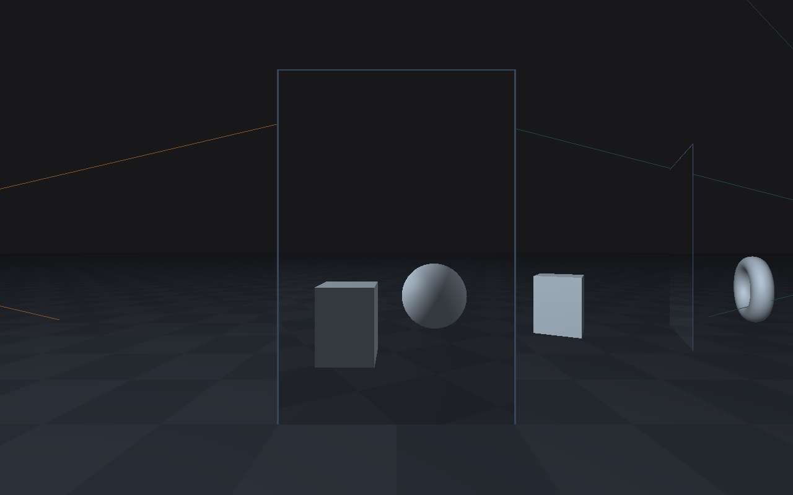
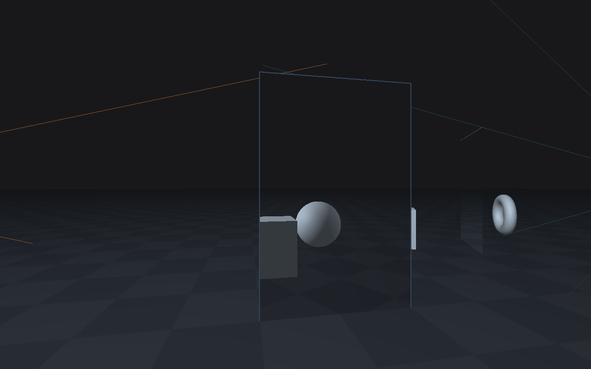
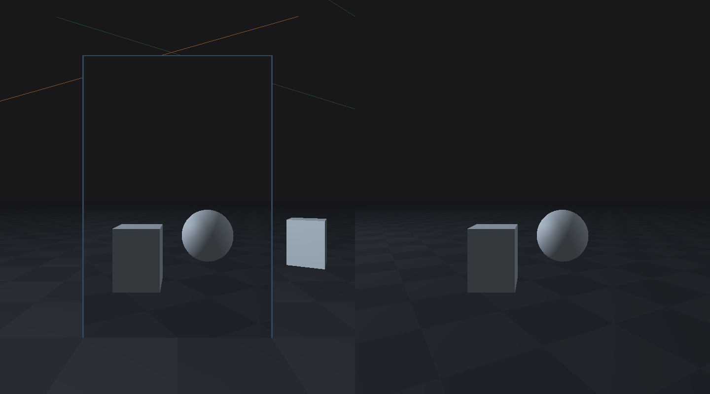

# Portal Demo 3D

A native macOS experiment that shows how a 3D scene looks through two connected portals, built with Swift and Metal.



*The starting view. The framed opening shows the scene from the connected camera; the thin teal and amber lines visualize the two mapped cameras' fields of view.*

[Quick start](#quick-start) · [Controls](#controls) · [Screenshots](#screenshots) · [How it works](#how-it-works) · [Rendering guide](Docs/RenderingGuide.md)

## What you can explore

- Move around a perspective scene and watch the view through each opening change with your camera.
- Inspect both directions: **A → B** maps the entrance to the exit; **B → A** maps the exit back to the entrance.
- Compare the main scene with an optional camera preview beside it.
- See how a cube, sphere, torus, and checker floor reveal depth and changing perspective.
- Change the portal placement, field of view, lighting, and debug views in one configuration file.

This is a rendering experiment. Walking through an opening does not teleport you. Exit-plane clipping, collision, and recursive portal views are still unimplemented.

## Quick start

### Requirements

- A Mac running **macOS 14 or later**, with a Metal-capable GPU.
- The full **Xcode** app, including its Metal toolchain. This checkout builds with Xcode 27.0.
- Git to clone the repository. There are no external packages or API keys to install.

### Run in Xcode

```sh
git clone https://github.com/safuentees/portal-demo-3d.git
cd portal-demo-3d
open MetslStarter.xcodeproj
```

1. Select the **MetslStarter** scheme and **My Mac** as the destination.
2. Press **Command-R** to build and run.
3. In the **Metsl Starter** window, click the scene and use the controls below.

The project and application retain the name `MetslStarter`; this repository contains its 3D portal experiment.

## Controls

| Action | Control |
| --- | --- |
| Capture the mouse for looking around | Click the scene |
| Look around | Move the mouse while captured |
| Move forward / backward | **W** / **S** |
| Move left / right | **A** / **D** |
| Release the mouse and clear held input | **Escape** |
| Reset the camera | Close and reopen the app window |

Try moving sideways while looking through the entrance. The nearer cube shifts more than the farther sphere, making their depth difference visible. Press **Escape** before switching to another app.

## Screenshots

### View the opening from an angle



*Moving left and turning toward the entrance changes which part of the destination scene is visible.*

### Compare the scene and mapped camera



*Left: the main scene. Right: the full A → B camera image. The opening on the left displays the corresponding portion of that image.*

Enable this layout by setting `showsMappedPreview = true` in [SceneConfiguration.swift](Sources/Scene/SceneConfiguration.swift), then rebuild and run. The preview is off by default; both portal images still render while it is hidden.

These images were captured on October 9, 2026, directly from the application's Metal renderer. They use the bundled scene and shaders, with a moved camera for the oblique view and the preview enabled for the comparison. No scene configuration or application code was changed for the captures.

## How it works

A **portal camera** is a copy of your camera's pose transformed from one opening's coordinate frame into the other's. The renderer makes a camera for each direction.

Every frame follows three steps:

1. Render the **A → B** camera into a GPU image.
2. Render the **B → A** camera into a separate GPU image.
3. Draw the main scene, displaying each image on its corresponding opening. When enabled, the right preview shows the full A → B image.

Each opening samples the image at the matching screen position, so the image follows your perspective rather than being stretched to fit the opening. Ordinary depth testing lets foreground objects cover it. Both captures omit the portal display surfaces and debug outlines.

The mapping uses row vectors and rigid frames, which include rotation and translation but exclude visual scale:

```text
A → B = inverse(entranceFrame) * exitFrame
B → A = inverse(A → B)
mappedCameraWorld = sourceCameraWorld * mapping
```

For the scene layout, transform order, torus geometry, floor filtering, lighting, shader layout, and test details, see the [rendering guide](Docs/RenderingGuide.md).

## Customize the scene

Start in [SceneConfiguration.swift](Sources/Scene/SceneConfiguration.swift). Edit a setting, then rebuild and run; these are code settings, not runtime switches.

| Setting | Default | What it changes |
| --- | --- | --- |
| `showsMappedPreview` | `false` | Adds the A → B camera image beside the main view |
| `showsMappedFOV` | `true` | Shows both mapped camera outlines in the main scene |
| `showsDiagnosticObjects` | `false` | Adds objects for inspecting occlusion and future clipping work |
| `entrancePlacement`, `exitPlacement` | Configured scene placements | Moves, rotates, or resizes the openings |
| `fieldOfViewRadians` | 70° in radians | Sets the vertical viewing angle for cameras and outlines |
| `nearPlane`, `farPlane` | `0.1`, `100` | Sets the visible depth range in world units |
| `cameraSpeed`, `mouseSensitivity` | `1.5`, `0.01` | Adjusts movement and mouse look |
| `floorCheckerSize` | `1` | Sets the checker square size in world units |

Positions and dimensions use world units; angles use radians. The lighting controls and landmark placements are in the same file.

## Project structure

The app uses **SwiftUI**, **AppKit**, **MetalKit**, **Model I/O**, and **SIMD**, with custom Metal shaders and no third-party dependencies.

```text
MetslStarter.xcodeproj       Xcode project and shared scheme
Sources/
  App/                      App entry point and window
  Views/                    SwiftUI-to-Metal view setup
  Input/                    Keyboard, mouse, and cursor capture
  Scene/                    Configuration, camera, and transforms
  Rendering/                Meshes, render objects, uniforms, and passes
  Shaders/                  Metal shaders
Tests/                      Math, input, geometry, and GPU checks
Scripts/check.sh            Build and validation entry point
Docs/RenderingGuide.md      Detailed implementation notes
```

To follow the implementation, start with [SceneConfiguration.swift](Sources/Scene/SceneConfiguration.swift), then [Transforms.swift](Sources/Scene/Transforms.swift), [Renderer.swift](Sources/Rendering/Renderer.swift), and [Shaders.metal](Sources/Shaders/Shaders.metal).

## Build and verify

Run the existing check script from the repository root. An isolated temporary directory keeps build products separate from source files and other projects:

```sh
BUILD_DIR="$(mktemp -d /tmp/portal-demo-3d-check.XXXXXX)" ./Scripts/check.sh
git diff --check
```

The script builds the Debug app and runs math, input, mesh, shader-layout, and offscreen rendering checks with Metal API validation. It needs the full Xcode toolchain and access to a Metal GPU. Input checks use simulated cursor callbacks; actual cursor visibility and association still need manual inspection.

For this documentation update, the Debug app build and the three GPU image captures succeeded. The full check suite was not rerun. Earlier test results and their limits are preserved in the [rendering guide](Docs/RenderingGuide.md#verify).

## Current limitations

- **No teleportation or collision:** movement can pass through scene geometry without transferring the camera to the other opening.
- **No exit-plane clipping:** geometry between a mapped camera and its destination plane can still appear in the portal image.
- **No recursion:** portal surfaces are excluded from camera captures, so nested portal views are not rendered.
- **One portal pair:** this experiment does not implement a general multi-portal system.
- **Simple lighting:** no shadow maps or distance attenuation; colors use the existing direct display-value workflow.

## Help and contributions

Maintained by [@safuentees](https://github.com/safuentees). Report a problem or propose an improvement in the [issue tracker](https://github.com/safuentees/portal-demo-3d/issues). Include your macOS and Xcode versions, steps to reproduce, and the relevant build output or screenshot.

Before changing code, read [AGENTS.md](AGENTS.md), keep the change focused, and run `Scripts/check.sh`. Documentation changes should retain working links and accurate descriptions of implemented features. The [development review](Docs/DevelopmentReview.md) explains earlier experiments and fixes.

## License

This repository does not currently include a `LICENSE` file.

## README references

The layout follows [GitHub's official README guidance](https://docs.github.com/en/repositories/managing-your-repositorys-settings-and-features/customizing-your-repository/about-readmes) and adapts the overview, setup, usage, and contribution structure of [Best-README-Template](https://github.com/othneildrew/Best-README-Template) and [Standard README](https://github.com/RichardLitt/standard-readme). The latter two are community templates.
